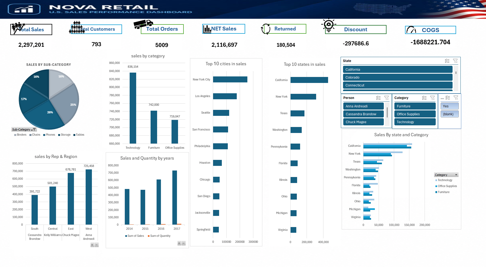

# Nova Retail: U.S. Sales Performance Dashboard (Excel)

An interactive Excel dashboard built with Power Query, Power Pivot (Data Model) and PivotCharts on four years of U.S. retail orders (2014–2017).

## Business question

Where do sales come from (category, product, region, state, city and sales rep), how much is lost to returns and discounts, and how is the business growing year over year?

## Data

| | |
|---|---|
| Source | Superstore retail sample dataset (training course material) |
| Orders | 9,994 order lines · 5,009 orders · 793 customers · 2014–2017 |
| Lookup tables | `Return` (296 returned orders) · `People` (regional managers) · `Shipping Cost` (cost per unit by state) |

## What I built

1. **Power Query (M):** imported the raw workbook, split `Location` into Country and City, rebuilt the ship date from a numeric code, and added calculated columns: discount value, COGS, serial number and delivery days. The full query is in [`power-query/Orders.m`](power-query/Orders.m).
2. **Data Model (Power Pivot):** related Orders, Returns, People and Shipping Cost, and created measures for total customers, total orders, profit per customer and profit per order.
3. **Dashboard:** 7 KPI cards (Total Sales, Customers, Orders, Net Sales, Returned, Discount, COGS), 8 PivotCharts and slicers for State, Person, Category and Returned.

## Data quality fix

The raw `Ship Date` is stored as a number such as `1101102016` (month 11, day 11, year 2016). The first version of the query dropped the zero from month **10**, so every October shipment became January and **287 rows** showed negative delivery times (down to −274 days).

I rewrote the step to rebuild the date correctly and validate it against the order date. Result: delivery time is now **0–7 days, average 4 days**, for all 9,994 rows.

## Key figures

| KPI | Value |
|---|---|
| Total sales | 2,297,201 |
| Net sales (excluding returned orders) | 2,116,697 |
| Sales of returned orders | 180,504 (5.9% of orders, 7.9% of sales) |
| Total profit | 286,397 (12.5% margin) |

## Findings

| Finding | Evidence |
|---|---|
| Heavy discounts destroy profit | Lines with discounts above 40% lose 77% of their sales; lines with no discount earn a 29.5% margin |
| Furniture sells but barely profits | 742k in sales at a 2.5% margin, vs about 17% for Technology and Office Supplies; Tables alone lost 17.7k |
| High sales do not mean high profit | Texas is the 3rd largest state by sales but the biggest loss (−25.7k profit) |
| Sales are growing | 484k in 2014 → 733k in 2017 |

## Limitations

- Profit is taken as given in the source data; it is not clear whether the separate shipping cost table (about 226k in total) is already included in it.
- Sample dataset: findings describe this data, not a real company.

## How to open

Open `Nova_Retail_Sales_Dashboard.xlsx` in Excel for Windows (Power Pivot required for the Data Model). To refresh from the raw file, update the file path in Power Query.

## Author

**Omar Saad Abu Al-Khair**, Data Analyst · [LinkedIn](https://www.linkedin.com/in/omar-abualkhair) · [Portfolio](https://omar-abualkhair.github.io)
